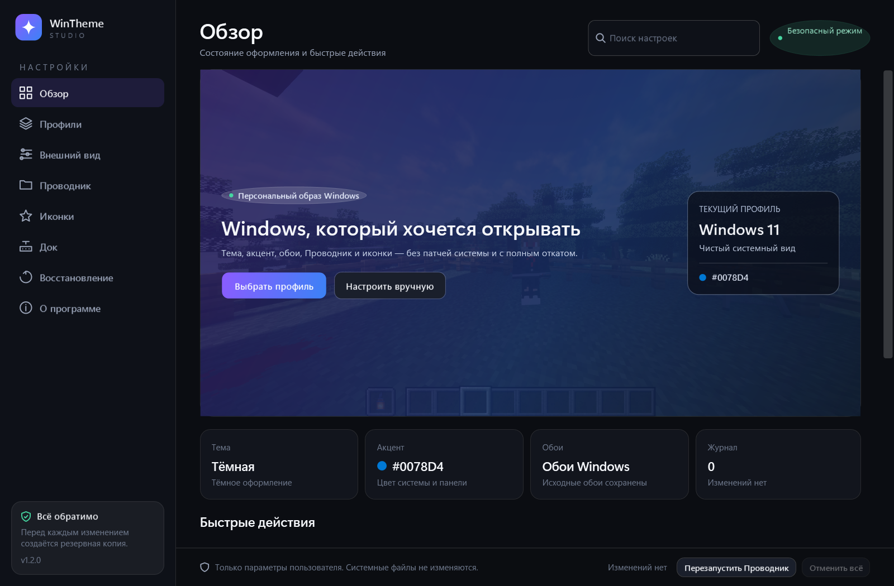
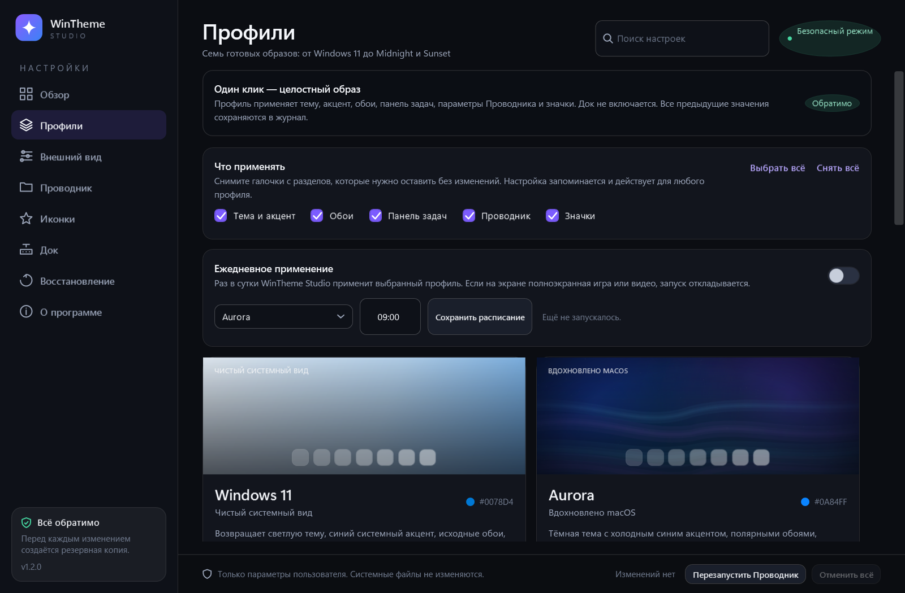
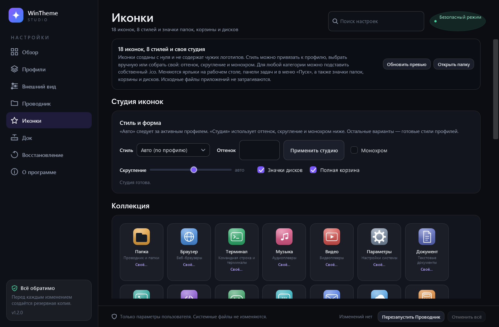
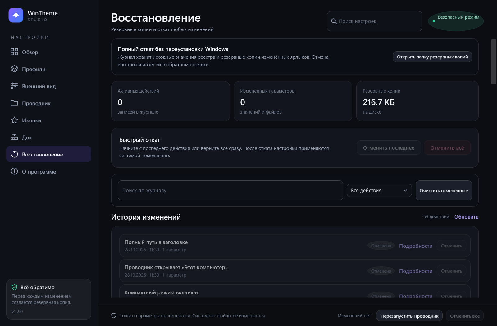

# WinTheme Studio

Безопасная и обратимая персонализация Windows 11: тема, акцентный цвет, оригинальные обои,
иконки ярлыков, папок, корзины и дисков, а также необязательный плавающий док — без патчей
системы, служб, драйверов и постоянных прав администратора.

Приложение написано на C# / WPF для .NET 10, собирается в один self-contained `.exe` для
`win-x64` и работает от обычного пользователя.

## Скачать

[**WinTheme Studio 1.2.0 — GitHub Releases**](https://github.com/mial2013michail-stack/wintheme-studio/releases/latest)

В релизе: портативный `WinThemeStudio.exe`, ZIP с документацией и скриншотами, а также
`SHA256SUMS.txt`.

## Возможности

- **Семь профилей одним кликом.** Windows 11, Aurora (в духе macOS), Aubergine (в духе Ubuntu),
  Minimal, Midnight, Mint и Sunset. Профиль меняет тему, акцент, обои, панель задач, параметры
  Проводника и значки. Док включается отдельно и никогда не появляется сам.
- **Предпросмотр и выборочное применение.** Перед применением профиля видно, что изменится:
  текущее состояние рядом с целевым и список шагов. Можно снять галочки «Тема», «Обои»,
  «Панель задач», «Проводник», «Значки» — выбранные разделы запоминаются для следующих запусков.
- **Внешний вид.** Светлая и тёмная тема, 10 готовых акцентов и свой HEX-цвет, восемь
  оригинальных обоев, автоматическое извлечение акцента из обоев, прозрачность и анимации.
  Режимы обоев: заполнить, вписать, растянуть, по центру, черепицей и обрезать под экран.
- **Иконки.** 18 оригинальных иконок и 8 стилей: Default, Aurora, Aubergine, Minimal, Midnight,
  Mint, Sunset и «Студия». В студии настраиваются оттенок, скругление и монохром; для любой
  категории можно подставить собственный `.ico`. Меняются ярлыки `.lnk` на рабочем столе,
  панели задач и в меню «Пуск», а также значки всех папок, пустой и полной корзины и локальных
  дисков. Исполняемые файлы приложений не затрагиваются.
- **Проводник и панель задач.** Центрирование значков, секунды в часах, виджеты, чат, режим
  кнопки поиска, расширения файлов, скрытые файлы, компактный режим, запуск с «Этот компьютер»,
  полный путь в заголовке, показ значков рабочего стола и классическое контекстное меню
  Windows 10. Перезапуск Проводника не выполняется поверх полноэкранной игры без подтверждения.
- **Расписание.** Выбранный профиль применяется раз в сутки в заданное время. Если на экране
  полноэкранная игра или видео, запуск откладывается. Расписание работает, пока приложение
  запущено, в том числе свёрнутым в трей; отдельную задачу в Планировщике Windows оно не создаёт.
- **Трей и поиск.** Быстрое меню в трее: профили, отмена последнего действия, полный откат,
  открыть окно и выход. Поиск по настройкам в шапке окна переходит к нужному разделу.
- **Док.** Необязательная плавающая панель приложения с настройкой положения, размера,
  автоскрытия, размытия и увеличения. По умолчанию выключена, не входит в профили и
  автоматически прячется в полноэкранных играх и видеоплеерах.
- **Полный откат.** Журнал хранит исходные значения реестра и резервные копии изменённых
  файлов. Можно отменить последнее действие, отдельную запись или всё сразу. В журнале есть
  поиск, фильтры, подробности по каждой транзакции и очистка отменённых записей; незавершённые
  после аварийного завершения транзакции восстанавливаются и остаются отменяемыми.
- **Русский интерфейс** и работа без установки.

## Скриншоты

| Обзор | Профили |
| --- | --- |
|  |  |

| Иконки | Восстановление |
| --- | --- |
|  |  |

## Безопасность и обратимость

WinTheme Studio меняет только:

- разделы **HKCU** (текущий пользователь);
- файлы внутри профиля пользователя и в пользовательских папках: ярлыки `.lnk` на рабочем
  столе, панели задач и в меню «Пуск», собственные копии обоев и данных приложения. Рабочий
  стол и панель задач могут быть перенаправлены на другой диск — это поддерживается.

Перед каждым изменением исходное значение или файл записывается в журнал. Отмена
восстанавливает значения в обратном порядке и обновляет оболочку.

Приложение **не** делает следующего:

- не изменяет системные файлы, службы, драйверы и загрузчик;
- не патчит `UxTheme`, `Explorer.exe`, тему входа и экран блокировки;
- не отключает проверку подписи, Defender или защиту Windows;
- не требует постоянных прав администратора и не устанавливает службы;
- не скачивает чужие обои, логотипы и иконки;
- не отправляет сетевые запросы и телеметрию.

Точка восстановления Windows — необязательный дополнительный шаг на странице «О программе».
Он запускается отдельно и требует подтверждения UAC; для обычной работы приложения UAC не
нужен.

## Что именно меняется

| Область | Расположение |
| --- | --- |
| Тёмная/светлая тема, прозрачность | `HKCU\Software\Microsoft\Windows\CurrentVersion\Themes\Personalize` |
| Акцентный цвет | `HKCU\Software\Microsoft\Windows\DWM`, `...\Explorer\Accent` |
| Обои и режим отображения | `HKCU\Control Panel\Desktop` (`Wallpaper`, `WallpaperStyle`, `TileWallpaper`) |
| Панель задач и Проводник | `HKCU\Software\Microsoft\Windows\CurrentVersion\Explorer\Advanced` |
| Классическое контекстное меню | `HKCU\Software\Classes\CLSID\{86ca1aa0-34aa-4e8b-a509-50c905bae2a2}\InprocServer32` |
| Кнопка поиска | `HKCU\Software\Microsoft\Windows\CurrentVersion\Search` |
| Значки папок, корзины и дисков | `HKCU\Software\Microsoft\Windows\CurrentVersion\Explorer\Shell Icons` |
| Автозапуск (по желанию) | `HKCU\Software\Microsoft\Windows\CurrentVersion\Run` |
| Ярлыки | файлы `.lnk` на рабочем столе, панели задач и в меню «Пуск» |

Настройки дока, студии иконок, выборочного применения и расписания хранятся только в
конфигурации приложения и не попадают в реестр. Профили не включают док.

## Профили

| Профиль | Стиль | Акцент | Обои | Панель задач | Значки |
| --- | --- | --- | --- | --- | --- |
| Windows 11 | Чистый системный вид | `#0078D4` | Исходные обои | По центру, поиск-поле, виджеты | Исходные |
| Aurora | Вдохновлено macOS | `#0A84FF` | Aurora | По центру, поиск-значок, секунды | Aurora: синие папки, индиго-корзина |
| Aubergine | Вдохновлено Ubuntu | `#E95420` | Aubergine | Слева, поиск-поле, секунды | Aubergine: оранжевые папки, фиолетовая корзина |
| Minimal | Тише и спокойнее | `#9AA3B2` | Graphite | По центру, поиск скрыт, без анимаций | Minimal: графитовые папки и корзина |
| Midnight | Ночь и золото | `#D4AF37` | Midnight | По центру, золотой акцент | Midnight: тёмно-синие папки, золотая корзина |
| Mint | Свежий и светлый | `#2FA37C` | Mint | По центру, зелёный акцент | Mint: мятные папки и корзина |
| Sunset | Тёплый закат | `#FF7A45` | Sunset | Слева, оранжевый акцент | Sunset: тёплые папки и корзина |

Профиль также настраивает прозрачность, анимации, расширения файлов, скрытые файлы и
компактный режим Проводника. Профиль «Windows 11» возвращает исходные значки и системные
значения. Док не включается ни одним профилем — его можно включить вручную на странице «Док».

Профили лишь вдохновлены стилем macOS и Ubuntu. В приложении нет логотипов и фирменных
материалов этих систем. Остальные профили — самостоятельные авторские композиции.

## Быстрый старт

1. Запустите `WinThemeStudio.exe`.
2. Откройте «Профили», нажмите «Предпросмотр», проверьте план и примените подходящий образ —
   или настройте всё вручную.
3. Если что-то не понравилось, откройте «Восстановление» и нажмите «Отменить последнее» или
   «Отменить всё». Быстрые команды есть и в меню значка в трее.

Файл не подписан сертификатом. При первом запуске SmartScreen может показать предупреждение:
выберите «Подробнее» → «Выполнить в любом случае». Это обычное поведение для небольших
открытых приложений без платной подписи кода.

Требования: Windows 11 x64 (рекомендуется 22H2 или новее). Устанавливать .NET отдельно не
нужно — исполняемый файл самодостаточный.

## Данные и конфиденциальность

Все данные находятся в `%LOCALAPPDATA%\WinThemeStudio`:

- `config.json` — настройки приложения, дока, студии иконок, выборочного применения и расписания;
- `journal.json` — история изменений и исходные значения;
- `backups\` — резервные копии ярлыков и файлов;
- `wallpapers\` — сгенерированные обои и миниатюры;
- `icons\pack\` — сгенерированный набор иконок;
- `original-wallpaper.png` — копия исходных обоев;
- `dry-run.txt` — последний план профиля из командной строки;
- `logs\` — текстовый журнал приложения.

Сетевых запросов нет. Удаление папки данных сбрасывает настройки приложения, но не отменяет
уже применённые изменения Windows — для этого используйте «Отменить всё» перед удалением.

## Командная строка

| Ключ | Назначение |
| --- | --- |
| `--tray` | Запуск свёрнутым в трей (используется автозапуском). |
| `--screenshot <папка>` | Полностью off-screen рендер всех страниц в PNG без видимого окна. |
| `--selftest <папка>` | Проверка журнала, отката реестра и файлов, значков, обоев, профилей и расписания. |
| `--apply-profile <ключ>` | Применить профиль (`windows`, `aurora`, `aubergine`, `minimal`, `midnight`, `mint`, `sunset`) без открытия окна. |
| `--dry-run [ключ]` | Показать план профиля, ничего не меняя; пишет `dry-run.txt`. По умолчанию `aurora`. |
| `--export-profile <ключ> [файл]` | Выгрузить профиль и его план в JSON. |
| `--list-profiles` | Показать профили, акценты, обои и стили значков. |
| `--undo-last` | Отменить последнее действие из журнала. |
| `--undo-all` | Полный откат всех изменений из журнала. |
| `--help` | Краткая справка по ключам. |

`--screenshot`, `--selftest`, `--apply-profile`, `--dry-run` и `--undo-*` не показывают окно и не
включают док. `--selftest` использует только собственные тестовые разделы
`HKCU\Software\WinThemeStudio\SelfTest`, создаёт временный ярлык с уникальным именем,
восстанавливает журнал и удаляет тестовые данные после проверки.

## Сборка из исходников

Нужен [.NET 10 SDK](https://dotnet.microsoft.com/). Сторонние NuGet-пакеты не используются.

```powershell
# Обычная сборка
dotnet build .\src\WinThemeStudio\WinThemeStudio.csproj -c Debug

# Публикация одного self-contained exe в dist
powershell -ExecutionPolicy Bypass -File .\tools\publish.ps1
```

Скрипт публикации собирает `Release` / `win-x64` / single-file, копирует в `dist` документы и
проверяет наличие исполняемого файла. Готовый файл: `dist\WinThemeStudio.exe`.

Проверка интерфейса без показа окна:

```powershell
.\dist\WinThemeStudio.exe --screenshot .\dist\screenshots
.\dist\WinThemeStudio.exe --selftest .\dist\qa
```

Скриншоты находятся в `screenshots\` рядом с исполняемым файлом. Отчёт самопроверки —
`qa\selftest.txt` (или в папке, указанной в командной строке).

## Структура проекта

```
src/WinThemeStudio/
  Core/        пути, JSON-хранилище, журналирование
  Models/      модели конфигурации и журнала
  Services/    тема, обои, иконки, ярлыки, журнал, профили, расписание, автозапуск
  Interop/     Win32 и COM-обёртки для ярлыков
  Overlays/    плавающий док
  Themes/      стили WPF
  UI/          страницы, диалоги, off-screen скриншоты
  Assets/      иконка приложения
docs/          изображение иконки
tools/         скрипты иконки и публикации
dist/          готовый exe, лицензия и скриншоты
```

## Ограничения и известные особенности

- Глубина оформления ограничена документированными параметрами Windows 11. Приложение не
  заменяет системную тему, проводник и панель задач.
- Часть параметров панели задач и Проводника применяется после перезапуска оболочки;
  кнопка перезапуска есть на странице «Проводник». При полноэкранном приложении перезапуск
  требует явного подтверждения.
- Иконки применяются к ярлыкам `.lnk` (рабочий стол, панель задач, меню «Пуск»), а также к
  папкам, корзине и дискам через документированный раздел HKCU. Файлы внутри программ и
  элементы UWP не затрагиваются. Кэш значков оболочки может обновиться не сразу — перезапустите
  Проводник.
- Собственный `.ico` используется в стиле «Студия»; готовые стили профилей остаются
  неизменными. Формат значка — `.ico` с размерами до 256×256.
- Расписание — это таймер внутри приложения, а не задача Планировщика Windows. Оно срабатывает,
  когда WinTheme Studio запущена (в том числе в трее), и пропускает день, если приложение было
  закрыто. Пропущенный запуск не повторяется задним числом.
- Док — отдельное окно WinTheme Studio, а не системная панель задач. Он скрывается в
  полноэкранных приложениях, но не заменяет оболочку Windows.
- На некоторых сборках Windows 11 система запрещает менять кнопку виджетов (`TaskbarDa`).
  Профиль в этом случае применяет всё остальное, а в журнал пишется предупреждение.
- Сторонние темы, патчи `UxTheme`, изменение экрана входа и системных файлов не
  поддерживаются намеренно.
- После крупного обновления Windows некоторые параметры могут сброситься самой системой;
  журнал при этом продолжает работать.

## Лицензия и товарные знаки

Код и оригинальная графика распространяются по лицензии MIT (см. `LICENSE`). Сторонние
компоненты и товарные знаки описаны в `THIRD-PARTY-NOTICES.md`. Windows, macOS и Ubuntu —
товарные знаки соответствующих правообладателей; WinTheme Studio не связан с Microsoft,
Apple и Canonical.

© 2026 WinTheme Studio.
